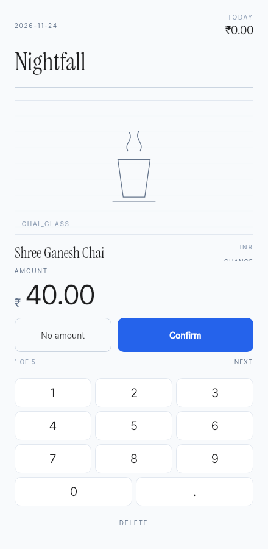
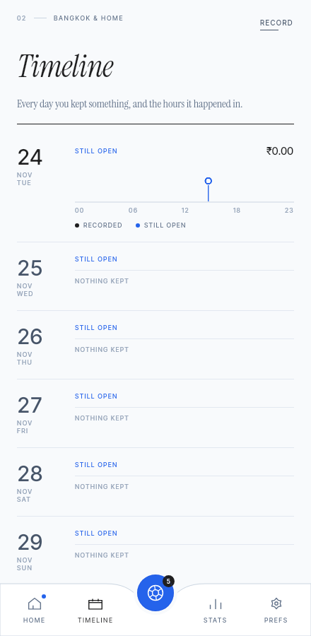
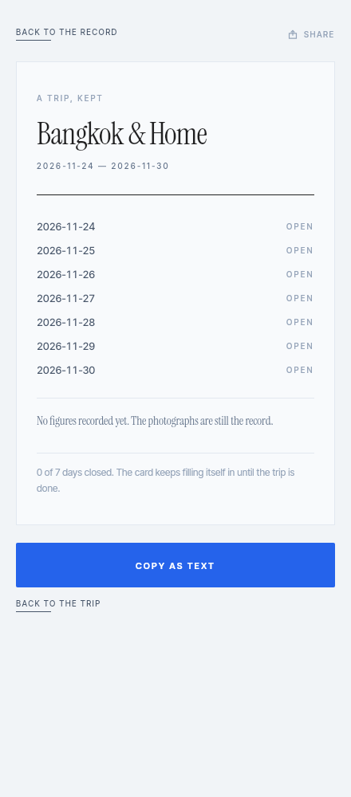

You spent forty rupees on chai and twelve hundred on shoes, and by tonight you won't remember either. **Ariadne** takes the photo now and lets you tally at nightfall.

<p align="center"><em>Ariadne — the thread you follow back through the day.</em></p>

---

## What it is

A trip-scoped spend memory. Not an expense tracker, not a travel app: a net for the
record you would otherwise lose between a market stall and a hotel room.

- **Capture is a photo.** No amount, no category, no note. One thumb, under two
  seconds, workable with the radio off. The camera opens inside the app - a
  CameraX viewfinder on Android - so the shutter is one tap from Nightfall
  rather than one app switch away.
- **The numbers wait for nightfall.** A card stack of the day, photo dominant,
  two taps each, keyboard first on desktop.
- **Being half-filled is allowed.** Extraction is best effort. When it fails the
  field is blank, not an error — and the capture is still a record.
- **Two currencies from the first minute.** Original amount always visible under
  the converted figure, rounding applied once, at the conversion boundary.
- **It ends.** The trip closes into a card you keep. No account, no server, no
  sync, nothing leaving the device.
- **It survives upgrades.** An install made by an older build opens its own
  database, migrates it, and keeps the trip. The schema version moves whenever
  the tables do, and the upgrade path is exercised against a real v1 file.

## The promise this repo keeps in code, not in slides

| Claim | Where it lives |
|---|---|
| Money is never a float | `Money` value class over `Long` minor units — `core/model` |
| A capture cannot be lost | photo → row → shutter returns — `CaptureCommitter`, `Outbox` |
| Extraction failure is silent | `sealed ExtractionOutcome.Failed` renders as a blank field |
| Every state transition is legal or refused | `QueueState.next`, a total function |
| No red, ever | `AriadneColors` has no red; Material's `error` is mapped to indigo |
| Search by what you remember | `SearchIndex`: merchant, price, day, currency — one index |
| Retries survive a dead zone | backoff persisted on the row, resumed on start |
| A button never silently does nothing | `commitDraft` reports a failed write on the page; `failureNote` in Prefs |
| An old install keeps its data | `openOrMigrate`: decides from the columns present, not from `PRAGMA user_version` |
| Startup cannot be blocked by background work | every step in `AppModel.start()` is guarded on its own |

## The screens

Real frames, rendered from the shared Compose UI by `tools/run-preview.sh --shots`
— not mockups. Palette and components from a sign-in reference, structure and type
from a trips reference; see `docs/DESIGN.md`.

<p align="center">
  
  
  
  
</p>

Home · Nightfall · Timeline · the card. The rest — onboarding, Stats, Prefs, the
shutter, the record, search, the desktop spread and the night paper — are in
[`docs/shots/`](docs/shots/).

## The design is a component library, not per-page layout

`core/design` is the whole visual language and every page is composed from it.
The point is not that it looks consistent - it is that a page cannot invent its
own version of a thing that already exists.

| Module | What it holds |
|---|---|
| `Bone.kt` | one palette, one type scale, one optical-correction table |
| `Components.kt` | `Rule`, `Tick`, `Label`, `Title`, `Body`, `Numeral`, `Action`, `OutlineAction`, `QuietAction` |
| `Blocks.kt` | `NavRow`, `SectionBreak`, `Framed`, `FigureRow`, `TapSurface` - the blocks pages kept retyping |
| `Motion.kt` | one duration, one curve, and the four effects built from them |
| `Plate.kt` | the drawn photographs, so every screen has a subject before it has data |

**Motion** is one vocabulary, deliberately small: `Motion.Page` is 180 ms, a single
ease-out with no overshoot. Four effects are built from it, and each one is a
function rather than a tween typed into a page:

- `Reveal(index)` - a list settles in, 34 ms behind itself, capped at six rows.
  Fades only; no slide, because a list that slides up is the most generic
  animation there is.
- the route crossfade plus `Motion.Drift` - ten points sideways as a page
  arrives, because the app is a book and pages turn across, not up. The index on
  Home and the ways into Search both use `Reveal`; Search's four example queries
  are live searches, not captions.
- `animatedLong` - a total counts to its new value. Money here is read in columns
  and compared against a fence, so the direction of a change matters. The value
  underneath stays a `Long`; the float exists only for the frames in between.
- `motionSpec` - the one place that asks `LocalMotionPreference`, so reduced
  motion is honoured everywhere and nothing animates when the platform says not
  to.

**Performance** is the same discipline applied to recomposition. The state object
is immutable and replaced wholesale on every keystroke, so a composable that
takes the whole state recomposes everything around it. The amount plate, the
keypad and the decisions take primitives now, and the columns are keyed on the
facts they actually read - typing a digit recomposes the amount and nothing else.

## Layout

```
:core:model    Money, CurrencyCode, LocalDay, Capture, sealed results
:core:time     Clock (injected; faked in tests)
:core:queue    outbox state machine, backoff, resume-on-start
:core:extract  receipt parser (pure Kotlin) + TextRecognizer interface + 30 fixtures
:core:fx       scaled-integer rate table, HALF_UP conversion, Tally
:core:search   in-memory inverted index
:core:store    SQLDelight schema + migrations, AriadneStore, openOrMigrate, photo store
:core:design   Ink: palette, Instrument Serif + Inter Tight, components, blocks, motion, plate
:ui:app        routes, AppModel, the four tabs and the six stacked pages
:app:android   :app:ios   :app:desktop   :app:wasm
```

`:core:*` never imports `:ui:*`. `:ui:*` never touches a driver. `expect/actual` is
confined to the driver, photo store and recognizer boundaries — everything else,
including every screen and the whole state machine, is `commonMain`.

## Tests

Everything below runs in this checkout with no Gradle and no device. All green:

| Gate | Command | Result |
|---|---|---|
| Domain logic | `./tools/test-domain.sh` | **70 tests** |
| The capture flow, walked end to end | `./tools/flow-check.sh` | **54 checks** |
| The store against a real SQLite file | `./tools/store-check.sh` | **59 checks, incl. three real database shapes** |
| Every page renders | `./tools/run-preview.sh --shots` | **21 frames** |
| All four entry points compile | `./tools/entry-check.sh` | android, ios, wasm, desktop |

The domain suites:

```
MoneyTest                10   minor units, scale, Indian grouping, no float drift
LocalDayTest              7   epoch round-trip over 40 years, leap days, day ranges
QueueStateMachineTest     9   the full machine, including every illegal transition
OutboxTest               12   ordering, resume-on-start, backoff, no-amount captures
ReceiptParserFixtureTest  8   30 real receipt shapes, incl. phone-number and GSTIN traps
FxTest                    12   HALF_UP once, inverse pairs, missing rates, multi-currency totals
SearchIndexTest           12   merchant / price / day / currency, results are captures
```

`store-check.sh` and `flow-check.sh` are the two that earn their keep, and the
reason is worth stating plainly because both were written after being wrong.

The store gate opens **three real database shapes**: the schema exactly as it
shipped at the first commit (kept verbatim in `tools/storecheck/baseline-v1.sql`
and regenerated from git history), a file created by an interim build that never
stamped its version, and a genuinely empty file. Only the last is allowed to
`create`. The earlier version of this test invented a "version 1" that no build
ever wrote to disk, so it passed while every real database in existence failed
with `no such column: capture.category`. A fixture is only worth anything if it
is the thing the user has.

The flow gate walks the same failure deliberately, with a store that refuses
every write, and asserts the form says so instead of sitting there looking dead.

## Database versions

The schema is at **3**, and the two migrations are `1.sqm` (capture gained
`category` and `note`) and `2.sqm` (trip gained `place` and `budgetMinor`).

The version number is written by `openOrMigrate`, not by the generated `create` -
that omission is what broke every existing install, so the opener does not trust
the number on its own. It decides from the file: no `trip` table means new; a
`trip` table means this app has been here before, whatever the pragma claims; and
a failed `migrate` is repaired by adding only the missing columns, because a
half-upgraded file makes `ALTER TABLE ... ADD COLUMN` fail with "duplicate column
name". On desktop, a file that cannot be reconciled is moved aside and kept -
never deleted - and the app opens.

## Run it

The four-target Gradle build has not been run in a sandbox with enough memory, so
the paths that are verified are Gradle-free:

```bash
./tools/run-preview.sh             # compile + open the real shared UI in a window
./tools/run-preview.sh --phone     # 420x860, the phone layout
./tools/run-preview.sh --shots docs/shots   # render every page to PNG, headless
./tools/test-domain.sh             # 70 domain tests
./tools/flow-check.sh              # 54 end-to-end state checks
./tools/store-check.sh             # the store on real SQLite, plus the migration
./tools/entry-check.sh             # all four entry points, signature-checked
```

See **[RUN.md](RUN.md)** for the full walkthrough, or `TESTING.md` for the short version. And on a machine with the memory for it, the real targets:

```bash
./gradlew :app:desktop:run          # the comfortable triage surface
./gradlew :app:wasm:wasmJsBrowserDevelopmentRun   # the browser build
./gradlew :app:android:assembleDebug
./gradlew jvmTest                    # the shared suites
```

## Status, honestly

Nov 23 2026, day one of a fourteen-day build. Verified in this checkout: the
model, the queue machine and its tests, the receipt parser with thirty fixtures,
FX, search, the schema **and its migration path**, the design system and its
motion vocabulary, the four tab destinations and the six stacked pages, and the
capture flow from shutter to card.

Three things are honestly not verified here, and the first one matters most:

- **No device and no emulator.** The Android camera compiles against
  signature-checked CameraX stubs, and the sensor has never been opened in this
  sandbox. The code is real; the hardware path stays unproven until it runs on a
  phone.
- **The four-target Gradle build** has not been run end to end - `BUILD-STATUS.md`
  records exactly what was and was not executed.
- **OCR is not bound on any target.** `TextRecognizer` returns a failure value
  that the UI handles correctly, which is why the demo roll ships with the app.

Performance was reported from real hardware and fixed at the sources found here:
a drain loop that raced itself, and recomposition scoped far wider than the
change. It has not been re-measured on a device from inside this sandbox.

Apache-2.0. Kotlin Multiplatform Contest 2027 entry.
