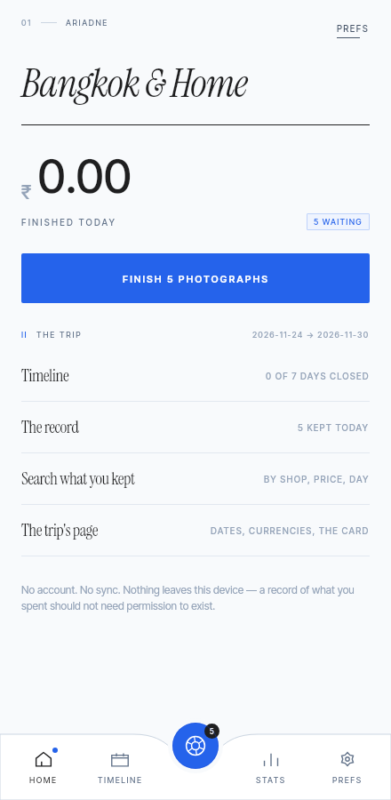

You spent forty rupees on chai and twelve hundred on shoes, and by tonight you won't remember either. **Ariadne** takes the photo now and lets you tally at nightfall.

<p align="center"><em>Ariadne — the thread you follow back through the day.</em></p>

---

## What it is

A trip-scoped spend memory. Not an expense tracker, not a travel app: a net for the
record you would otherwise lose between a market stall and a hotel room.

- **Capture is a photo.** No amount, no category, no note. One thumb, under two
  seconds, workable with the radio off.
- **The numbers wait for nightfall.** A card stack of the day, photo dominant,
  two taps each, keyboard first on desktop.
- **Being half-filled is allowed.** Extraction is best effort. When it fails the
  field is blank, not an error — and the capture is still a record.
- **Two currencies from the first minute.** Original amount always visible under
  the converted figure, rounding applied once, at the conversion boundary.
- **It ends.** The trip closes into a card you keep. No account, no server, no
  sync, nothing leaving the device.

## The promise this repo keeps in code, not in slides

| Claim | Where it lives |
|---|---|
| Money is never a float | `Money` value class over `Long` minor units — `core/model` |
| A capture cannot be lost | photo → row → shutter returns — `CaptureCommitter`, `Outbox` |
| Extraction failure is silent | `sealed ExtractionOutcome.Failed` renders as a blank field |
| Every state transition is legal or refused | `QueueState.next`, a total function |
| No red, ever | `AriadneColors` has no red; Material's `error` is mapped to indigo |
| Search by what you remember | `SearchIndex`: merchant, price, day, currency — one index |
| Retries survive a dead zone | backoff persisted on the row, resumed on start |

## The screens

Real frames, rendered from the shared Compose UI by `tools/run-preview.sh --shots`
— not mockups. Palette and components from a sign-in reference, structure and type
from a trips reference; see `docs/DESIGN.md`.

<p align="center">
  
  
  
  
</p>

Home · Nightfall · Timeline · the card. The rest — onboarding, Stats, Prefs, the
shutter, the record, search, the desktop spread and the night paper — are in
[`docs/shots/`](docs/shots/).

## Layout

```
:core:model    Money, CurrencyCode, LocalDay, Capture, sealed results
:core:time     Clock (injected; faked in tests)
:core:queue    outbox state machine, backoff, resume-on-start
:core:extract  receipt parser (pure Kotlin) + TextRecognizer interface + 30 fixtures
:core:fx       scaled-integer rate table, HALF_UP conversion, Tally
:core:search   in-memory inverted index
:core:store    SQLDelight schema, AriadneStore, photo store
:core:design   Ink: palette, Instrument Serif + Inter Tight, components, plate
:ui:app        routes, AppModel, the four tabs and the five stacked pages
:app:android   :app:ios   :app:desktop   :app:wasm
```

`:core:*` never imports `:ui:*`. `:ui:*` never touches a driver. `expect/actual` is
confined to the driver, photo store and recognizer boundaries — everything else,
including every screen and the whole state machine, is `commonMain`.

## Tests

Seventy tests run on the JVM in this checkout, all green:

```
MoneyTest                10   minor units, scale, Indian grouping, no float drift
LocalDayTest              7   epoch round-trip over 40 years, leap days, day ranges
QueueStateMachineTest     9   the full machine, including every illegal transition
OutboxTest               12   ordering, resume-on-start, backoff, no-amount captures
ReceiptParserFixtureTest  8   30 real receipt shapes, incl. phone-number and GSTIN traps
FxTest                    12   HALF_UP once, inverse pairs, missing rates, multi-currency totals
SearchIndexTest           12   merchant / price / day / currency, results are captures
```

## Run it

The four-target Gradle build has not been run in a sandbox with enough memory, so
the paths that are verified are Gradle-free:

```bash
./tools/run-preview.sh              # compile + open the real shared UI in a window
./tools/run-preview.sh --phone      # 420x860, the phone layout
./tools/run-preview.sh --shots docs/shots   # render every page to PNG, headless
./tools/test-domain.sh              # 70 domain tests
```

See **[RUN.md](RUN.md)** for the full walkthrough, or `TESTING.md` for the short version. And on a machine with the memory for it, the real targets:

```bash
./gradlew :app:desktop:run          # the comfortable triage surface
./gradlew :app:wasm:wasmJsBrowserDevelopmentRun   # the browser build
./gradlew :app:android:assembleDebug
./gradlew jvmTest                    # the shared suites
```

## Status, honestly

Nov 23 2026, day one of a fourteen-day build. What is done and verified here:
the model, the queue machine and its tests, the receipt parser with thirty
fixtures, FX, search, the schema, and the four tab destinations and five stacked pages. What is not yet
verified in this checkout: the four-target Gradle build itself has not been run
end to end (see `BUILD-STATUS.md` for exactly what was and was not executed), and
platform OCR is not yet bound on any target — it returns a failure value that the
UI handles correctly, which is why the demo roll ships with the app.

Apache-2.0. Kotlin Multiplatform Contest 2027 entry.
