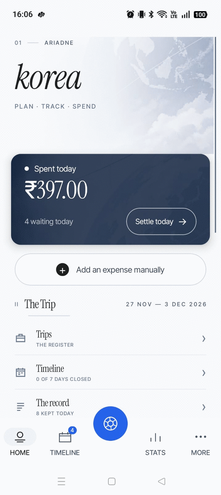
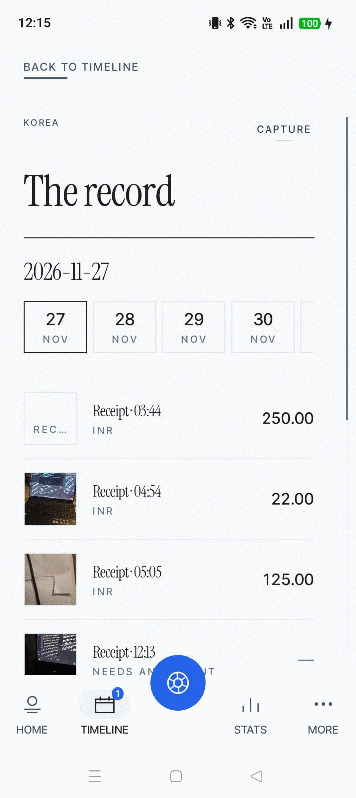

<p align="center">
  
</p>

# Ariadne

**A trip's spending, remembered as photographs — one shutter press in the shop, the figures settled at the end of the day.**

### ▶ [**Open the demo — a trip with photographs already in it**](https://armystay.github.io/ariadne/?seed=demo)

**No toolchain, no install, no account, no server.** That link runs the same shared Compose
UI that ships to Android, iOS and desktop, built by
[`pages.yml`](.github/workflows/pages.yml) and published as an artifact. It opens on a trip
that has already been kept, so the first frame is the record and not a title screen; the
bare [`/ariadne/`](https://armystay.github.io/ariadne/) opens on the introduction instead,
three beats and one button, for when you would rather be told what this is first.

<p align="center">
  
</p>

<p align="center"><em>Or point a phone at that.</em></p>

<p align="center">
  
</p>

<p align="center"><em>Two stills from a phone, 27 November 2026 — the home screen and one day's record.
A screen recording replaces this as soon as the next build is on the device.</em></p>

**Four targets, one codebase, compiled on every push — and one of them is honest about
what it does not have:**

| Target | Checked by | What it can do |
| --- | --- | --- |
| Shared domain + UI | `./gradlew jvmTest` (JVM test suites across the shared modules) | everything below is this code |
| Android | `:app:android:assembleDebug` | the whole thing: camera, photo library, voice, glasses |
| Desktop | `:app:desktop:compileKotlinJvm` | the ledger, the record, import from a file dialog, Tesseract |
| iOS | `:app:ios:compileKotlinIosArm64` + `compileKotlinIosSimulatorArm64` | **the ledger, search, the trip card, the codes — no camera, no photo import** |
| WebAssembly | `:app:wasm:compileKotlinWasmJs` | the ledger, import from a file input, no OCR, data lives in the tab |

The iOS line used to imply parity. It has no `PlatformPhotos` bridge, so the shutter has
no sensor and the picker has no library there; saying so is better than a table that
flatters the port. Closing that gap is a `PHPickerViewController` bridge and one Info.plist
key — [on the human list](docs/HUMAN-TASKS.md).

## The promise this repo keeps in code, not in slides

| Claim | Where it lives |
|---|---|
| Money is never a float | `Money` over `Long` minor units — `core/model` |
| A capture cannot be lost | photo → row → shutter returns — `CaptureCommitter`, `Outbox` |
| Extraction failure is editable, not fatal | `ExtractionOutcome.Failed`/blank results leave the capture queued for Close Day |
| Every state transition is legal or refused | `QueueState.next`, a total function |
| No red, ever | `AriadneColors` has no red; Material's `error` is mapped to indigo |
| Retries survive a dead zone | retry/backoff by outbox + extraction service, resumed on start |
| A button never silently does nothing | `commitDraft` reports a failed write on the page; `failureNote` in Preferences |
| An old install keeps its data | `openOrMigrate`: decides from the columns present, not from `PRAGMA user_version` alone |
| Local records, not a no-network guarantee | The app manifest explicitly declares `INTERNET` for Android exchange-rate requests; the glasses use DAT. No claim that SDK traffic is limited to the glasses has been verified |
| Rates have an offline fallback | Android requests rates from a public feed (`AndroidRateSource`), disclosing currency pairs and IP address; failures fall back to the last known rate |
| Startup cannot be blocked by background work | every step in `AppModel.start()` is guarded on its own |
| The trip card holds the trip | `Trip`, `TripCard` — the product screen and where it ends |
| A spoken amount is parsed by a pure function, not by a service | `SpokenExpense` over word and digit tokens — `core/model`, with tests |
| A shared trip is a copy, not a link | `ShareCodes` — a sixteen-character plan and a paste-able ledger, round-trip tested in `core/model`; no socket in either direction |
| Somebody else's figures are never merged into yours | `Traveller` / `TravellerEntry` in their own tables; quoted beside the day, absent from the card |
| One photograph can be deleted, and only on purpose | the × in the corner of `DetailPage`, twice — the bytes and the row, and no undo that pretends otherwise |
| The glasses are the camera when they are paired | `LocalWearableCapture` → `AndroidWearableCapture` over Meta's Wearables Device Access Toolkit |
| A missing recogniser or a missing pair is a sentence, not a crash | `VoiceEntry.listen` may answer null; every DAT call is wrapped and reported as `status` |

---

## What it is

You buy something small — a chai, a book, an extra train — and the receipt is in your
pocket until it isn't. Ariadne's capture gesture is one photograph, under two seconds,
with the phone already in your hand. **No amount is a legal entry**: the figure can
arrive while the card is on screen, later at Close Day, or never.

Two people can be on one trip without a server: one reads a code out, the other types it
in, and both phones have the same plan. When a day closes, a second code carries its
figures back — quoted beside your total, never merged into it. Nothing syncs. See
[**two phones, one ledger**](docs/UI-AND-FLOW.md#9-two-phones-one-ledger).

The record is per trip and per day. Home shows today's spend and what is waiting;
Timeline shows the trip and its days; Stats breaks it down; the record lists what you
kept. Records are stored locally, with no account or sync. Android rate requests disclose currency pairs and IP address, and its external voice recognizer may process audio remotely.

One thing reaches out of the app, and only as far as your own phone: the **evening
reminder**. Turn it on once (a single popup after the first trip, or Settings → *the
evening*), choose the hour, and at that time each day Ariadne says how many photographs
are still waiting for a figure. On Android it is an alarm the system keeps after the app
is closed; on desktop, iOS and the browser there is nothing to arm, so the same line
appears inside the app while it is open — and the panel says which of the two you are
getting rather than promising the first and delivering the second. No server, no push
service, no account.

## A photograph is the note

The reason a spending app gets abandoned is that it asks for the receipt to be re-typed.
So Ariadne asks for the picture first and lets the figure wait. Four ways in, cheapest
to rarest:

1. **The phone's camera** — the shutter in the dock. Nothing to enable, no hardware.
2. **The library** — a receipt you already photographed. **Library** on the shutter
   opens the system photo picker (up to twelve at once), the desktop's file dialog, or,
   in the browser demo, the page's own file chooser, which rescales to 1600px before the
   image is kept. It is the same record either way: an imported photograph meets the
   same two taps at Close Day as one taken at the counter.
3. **Your voice** — a microphone on Home, next to **Add an expense manually**, and a
   `Say the amount` row on the kept photograph. Say `twelve fifty`, `five euros fifty`,
   `coffee twelve fifty`; the figure and the merchant are filed. A spoken amount is a
   decision, so it lands confirmed. The parser is a pure function with tests
   (`SpokenExpense` in `core/model`); a sentence it cannot read is simply not a figure.
4. **Meta AI glasses** — optional, and **no hardware is needed to try this app**. If you
   own a pair, pair once (one panel, one trip to Meta AI), and the shutter takes the
   picture the glasses see instead of the phone's. The wiring is written against Meta's
   published SDK and compiles on every target; it has not been run against glasses from
   the machine it was written on, and a build needs your own app id to pair (see
   [What is proven where](#what-is-proven-where)).

## The rules

Five things the app will not do, because a record that bends is not a record:

- **A day that hasn't happened yet is not a record.** The shutter files into today, or
  into an earlier day of the trip if you say so — tap the day under the frame to change
  it, and the list of days it offers stops at today. Tomorrow is not on the list. A
  typed date is refused with a sentence, not an error dialog, and a trip that starts
  next month has no shutter at all until it starts.
- **No red.** Failure is a sentence in the same ink as everything else.
- **Local records, no sync.** Android rate requests disclose currency pairs and IP address;
  its external voice recognizer may send audio to its provider, even though Ariadne requests
  `EXTRA_PREFER_OFFLINE`. That hint is not enforced by Android; a warning appears before
  voice input, and typing stays available. Exports can leave the device.
- **A photograph needs a journey.** With no open trip the shutter explains itself
  instead of filing into nowhere.
- **Money is never a float**, and an amount you cannot convert is named in its own
  currency rather than added to the total.

## The screens

<p align="center">
  
  
</p>

Stills from a phone running a 27 November build; the dock's shutter has since gone navy
(`#1C3155`) and every filled action has followed it there, so the two stills predate
both. The design language is one file —
[`docs/DESIGN.md`](docs/DESIGN.md) — and every screen is described, screen by screen,
with the words it actually prints, in [`docs/UI-AND-FLOW.md`](docs/UI-AND-FLOW.md).

## Run it, install it, build it

**In a browser, one click:** [the demo, on a kept trip](https://armystay.github.io/ariadne/?seed=demo)
— no install, no account, no toolchain. The browser build keeps its record in the tab and
nothing else: there is no IndexedDB in it, so a reload starts again, and a private window
behaves exactly the same because there is no storage it could be refused. Look at it,
press everything, and do not type a trip you care about into it.

**On a phone: the second door.** [`v1.0.0`](https://github.com/ArmyStay/ariadne/releases/tag/v1.0.0)
carries `ariadne.apk`, and it is the only way to see the camera, the photo library, the
microphone and the glasses path — the browser cannot reach the sensor. **You do not need a
toolchain for it either:** download it on the phone and tap it, after allowing your files
app to install. The debug signature is expected; there is no Play listing, so Android will
say so once and then install.

It is large — around 120 MB — because five on-device OCR models are bundled rather than
downloaded, which is also whttps://github.com/ArmyStay/ariadne/pull/32/conflict?name=README.md&ancestor_oid=365eae4bc23ab05f41d6ee2242511572721729d8&base_oid=1f62c955dcf1ab79c7fa6c8ad52b408c21d5e81d&head_oid=8209ad5625699b4d4577141f04de0a476b7d7070hy recognition works in a shop with no signal. From a machine
with `adb` on it, the same thing in one line:

```bash
adb install -r ariadne.apk
```

New release builds require the GitHub Actions secrets `ARIADNE_KEYSTORE_BASE64`,
`ARIADNE_STORE_PASSWORD`, `ARIADNE_KEY_ALIAS`, and `ARIADNE_KEY_PASSWORD`.
Use a securely held production keystore; do not put it in this repository. An APK signed
with a different key cannot update an existing debug-signed installation in place.

Locally built debug APKs can drive the glasses path without glasses:

```bash
adb shell am start -n com.ariadne.app/com.ariadne.android.MainActivity --ez mock_glasses true
```

**From source** — every version, and the SDK path, is in
[`docs/SDK-SETUP.md`](docs/SDK-SETUP.md). How the demo is published, and everything else
that happened to get here, is in [`docs/TIMELINE.md`](docs/TIMELINE.md).

```bash
# The app, in a desktop window, from the shared UI
./tools/run-preview.sh

# Render every page to PNG — no emulator, no device
./tools/run-preview.sh --shots docs/shots

# Real targets (need a JDK and, for Android/iOS, an SDK or Xcode)
./gradlew :app:android:assembleDebug
./gradlew :app:desktop:run
./gradlew jvmTest
./gradlew :app:wasm:wasmJsBrowserDevelopmentRun   # or the local web demo
```

**Release and recovery:** see [Release and recovery](docs/RELEASE-AND-RECOVERY.md).
Existing debug-signed installations cannot be updated in place by a production-signed APK;
do not uninstall them while there is no restore path.

Every version those targets need — the JDK, the Android SDK path, `minSdk 29`, the
glasses artifacts, Xcode — is in [`docs/SDK-SETUP.md`](docs/SDK-SETUP.md).

The gates are plain shell scripts, so they run without a full toolchain; **the Gradle
build is the shipping path** and is what CI runs.

```bash
./tools/test-domain.sh      # the domain suites
./tools/flow-check.sh       # end-to-end state checks
./tools/store-check.sh      # the store on real SQLite, including the migration
./tools/entry-check.sh      # all four entry points, signature-checked
```

## What is proven where

Same facts as a claim table, sorted by who checks them.

**Proven by CI on every push** — the five targets above, plus the dependency review.
Green on `main` means the app compiles for Android, iOS, desktop and the browser, and the
shared test suites pass.

**Proven by CI on every deploy** — the demo link is fetched by a job with no
credentials: HTTP 200, and the page carries the wasm build's own script tag. Before it is
uploaded, `tools/demo-check.sh` serves the artifact locally under `/ariadne/`, the prefix
a project page actually uses, and every asset reference has to resolve there; `ci.yml`
runs the same check on every pull request. A green deploy means the link opens; it does
not mean an upload finished.

**Proven on a phone** — capture on the device, the day's stack, the record, the date
chips, and settings that survive a restart. The stills above are from that build.

**Not proven yet, and stated as such:**

- **A screen recording.** The GIF above is two stills, not a recording.
- **Meta AI glasses against real hardware.** The DAT code compiles
  (`com.meta.wearable:mwdat-core` / `:mwdat-camera` / `:mwdat-mockdevice`, 1.1.0) and
  follows the documented flow — `Wearables.initialize` at launch,
  `startRegistration(activity)`, then a session with `AutoDeviceSelector`, `addCamera`
  and `stream.capturePhoto()` — but it has never run against a pair of glasses. The mock
  device is how the path is exercised without hardware, and a build only pairs once the
  app id / client token are set from the Wearables Developer Center (they are `0`/`0`
  here, which is why Developer Mode is required).
- **The Android floor.** `minSdk 29`, moved up from 26 for the glasses SDK — that is the
  whole reason, and it is the only feature in the app that costs a device generation.
- **Speech** needs a device with a recogniser app; where there is none, the control says
  `No microphone in this build` and **Type it instead** stays available.
- **The browser's file dialog.** It compiles, and the photograph it returns is kept in
  the tab's memory and drawn in the record like any other (`app/wasm`: `BrowserPhotoPicker`,
  `BrowserPhotoFiles`, `BrowserPhotoImageRenderer`). It has not been driven from a
  browser in this build, so "open the chooser, keep the photo, see it in the record" is
  not among the things tested on a device.
- **iOS imports and capture.** The iOS target has no camera, no photo picker and no
  photo file store, so the Library control is not offered there and the shutter keeps a
  ruled plate. Text recognition (Vision) and the database do work.
- **A link that opens your trip for someone else.** The card saves as a PNG and copies as
  text, and the record exports as a ZIP — but there is no share link, no route pretending
  to be one, and nothing that syncs two phones.
- **The evening reminder firing on a real phone.** The Android path compiles —
  `AndroidReminders` arms an inexact daily `AlarmManager` alarm and `ReminderReceiver`
  posts one notification on a channel of its own — but no build in this repository has
  sat on a device until 20:00 with the app closed. The in-app fallback, the setting, and
  the once-only offer are exercised by the shared tests and the desktop renderer.

Apache-2.0. Kotlin Multiplatform Contest 2027 entry. The entry essay is
[`ESSAY.md`](ESSAY.md); the history is [`docs/TIMELINE.md`](docs/TIMELINE.md).
