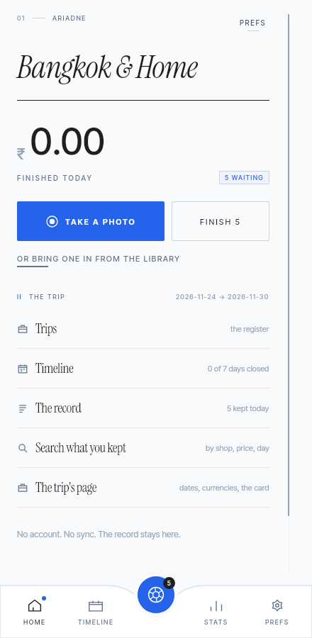
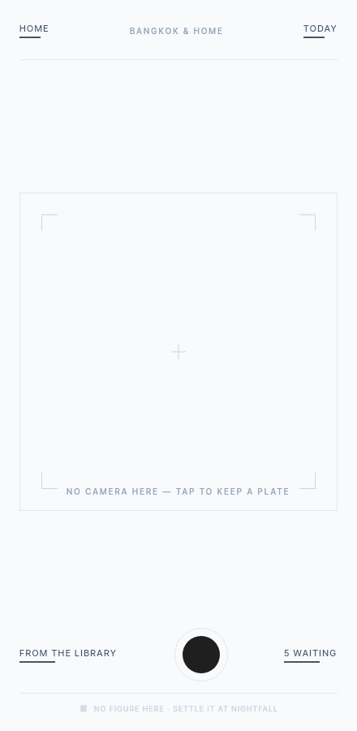
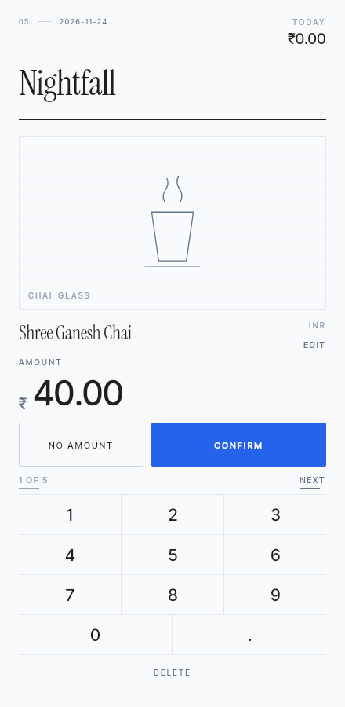
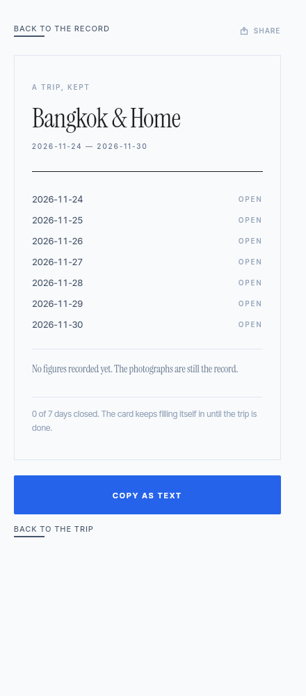

# Ariadne

Kotlin Multiplatform project — **Android** (Jetpack Compose), **iOS** (KMP Compose UI),
**Desktop** (Compose for Desktop) and **Web** (Kotlin/Wasm Compose UI). No account, no
server, no sync. The record never leaves the device; the only outbound request in the
product is for exchange rates, and the app works without it.

## Platforms

Android, iOS, Desktop, Web — and where we are headed (next up: iOS simulator, macOS,
WebP2P app, Additional Chromium?).

## What it is — the shape of the product

You spend a rupee here, something at night — a chai, a book, an extra train. So you don't. Ariadne is the record you would otherwise lose between a market stall and a hotel room, on the day you spend, and the day you don't.

- **One tab. One stack.** Each day is a small stack of cards; tapping a card (or rejecting the one auto-taken) builds the ledger. The whole state is your screenshot-and-export, nothing else.
- **Photo, not form.** The shutter fires one thumb, under two seconds, away from Nightfall — camera viewfinder inside the app, the plate takes the photo, money lives in the card stack.

> **Always a self-timer, on trip start and end. Not a budget, not a travel app — Ariadne is yours, and the only thing it leaves with you is a share link when you choose to share one.**

A quick tour of the four Pillars:

1. **Match the income** — pick which of your box totals to keep against this trip. The strings and totals are yours to choose.
2. **Plan trip month-end** — set a trip-end date and let your month land, one day at a time. Or plan your own trips on the side and keep both running.
3. **Track live** — image + text captured, cards of the day, the trips you manage (should the same value appear on two trips, tell me what happened), public share links.
4. **Everywhere, offline** — you are the source; nothing uploads; same trip on all platforms.

## The promise this repo keeps in code, not in slides

You'll see the same words a few times — that's because Ariadne is a place, not a
bucket of features.

| Claim | Where it lives |
|---|---|
| Money is never a float | `Money` over `Long` minor units — `core/model` |
| A capture cannot be lost | photo → row → shutter returns — `CaptureCommitter`, `Outbox` |
| Extraction failure is editable, not fatal | `ExtractionOutcome.Failed`/blank results leave the capture queued for Nightfall |
| Every state transition is legal or refused | `QueueState.next`, a total function |
| No red, ever | `AriadneColors` has no red; Material's `error` is mapped to indigo |
| Retries survive a dead zone | retry/backoff by outbox + extraction service, resumed on start |
| A button never silently does nothing | `commitDraft` reports a failed write on the page; `failureNote` in Prefs |
| An old install keeps its data | `openOrMigrate`: decides from the columns present, not from `PRAGMA user_version` alone |
| Only one outbound call, and it is optional | `app/android/src/main/AndroidManifest.xml` declares `INTERNET` for one GET to a public rate feed (`AndroidRateSource`); no trip data is sent, and every failure falls back to the last known rate |
| Startup cannot be blocked by background work | every step in `AppModel.start()` is guarded on its own |
| The trip card holds the trip | `Trip`, `TripCard`, `TripShare` — the product screen and where it ends |
| Cards stack only where they are due | the four tabs are Home/Timeline/Trip/Stats, and the card settles in Nightfall |

## The screens

Real frames, rendered from the shared Compose UI by `tools/run-preview.sh --shots` — not mockups.

> **These four frames are pre-third-review.** They were rendered from the build
> before the register bar, the closed-trip matrix, the square plate and the 44dp
> targets, so they show a design that no longer exists. They live in
> [`docs/shots/archive-2026-11-26-pre-third-review/`](docs/shots/archive-2026-11-26-pre-third-review/)
> with a note saying exactly what they predate. `docs/shots/` has no current
> render until the harness is run against this build; until then no screenshot in
> this repository is offered as evidence for a change.

<p align="center">
  
  
  
  
</p>

The shot list is now **44 frames**, fifteen of them at 200% system text and two in
landscape, plus the two closed-trip states. `./tools/run-preview.sh --shots docs/shots`
renders them; the harness fails the run if any surface claims the blue twice.

## How to run it — and a way to try ideas fast

Open the app in a window — a desktop window, that is:

```bash
./tools/run-preview.sh                  # the app in a desktop window
```

Or render every page to PNG — your eyes should remember this, and then search and see:

```bash
./tools/run-preview.sh --shots          # all 44 frames, into docs/shots/
```

New page? `./tools/run-preview.sh --shots --open Settings` — and then, right there, the page you chose, in real Compose UI with real state, debugger or screenshot tool on hand. Bigger reads: `./tools/test-domain.sh` is the 70. `./tools/store-check.sh` is the migration story, so you find out where it broke before someone else does.

```bash
./tools/run-preview.sh                  # compile + open the real shared UI in a window
./tools/run-preview.sh --shots docs/shots  # render every page to PNG, headless
./tools/test-domain.sh                  # 70 domain tests (Rounds the money, Export logic, AppModel)
./tools/flow-check.sh                   # 54 end-to-end state checks on your machine
./tools/store-check.sh                  # the store on real SQLite, plus the migration
./tools/entry-check.sh                  # all four entry points, signature-checked
```

Real targets (need a JDK + an Android SDK/Xcode):

```bash
./gradlew :app:desktop:run              # the comfortable triage surface
./gradlew :app:wasm:wasmJsBrowserDevelopmentRun   # the browser build
./gradlew :app:android:assembleDebug
./gradlew jvmTest                       # the shared suites
```

A quick way to start playing with new ideas: run `./tools/run-preview.sh --shots --open Settings` and step the pages around with a debugger — real Compose, real state, no emulator needed. Or `./tools/run-preview.sh --night` for the dark variant — which is also a real preference in the app now: **Preferences → Paper → Night**.

## Status, honestly

Implemented here: shared model/queue/parser/FX/search/store, schema migration path, design system, motion vocabulary, tabbed navigation and stacked pages, CameraX capture on Android, ML Kit text recognition on Android, extraction and confirmation, Nightfall, the trip card, Settings diagnostics.

Left for your machine and a bit of you:

- **A real phone:** capture and OCR — time on device until you say so.
- **Public share links (the `onShare` path) — broken or stripped:** there is a `Route.TripShare` entry in the router, but the share link is not complete yet.
- **Screenshots-from-your-machine / reality checks** of my claims on your build; mine are reasoned, yours are observed.

Everything is gradle-free for now: `BUILD-STATUS.md`, `TESTING.md`, `RUN.md` have the exact commands and outcomes on your machines.

Apache-2.0. Kotlin Multiplatform Contest 2027 entry.
